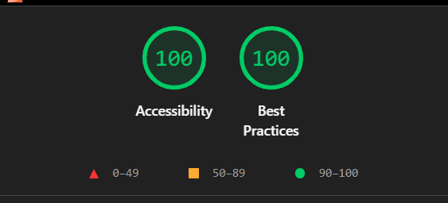

# HW1 — Drum Kit

A keyboard- and pointer-playable drum machine built with React. Seven pads can be triggered by physical key (`KeyboardEvent.code`), each hit is logged and drives a decibel meter.

Location: `src/homeworks/DrumMachine`

## Run

```bash
npm install
npm run dev -- --host 127.0.0.1     # development server
npm run build                       # production build
npm run preview -- --host 127.0.0.1 # serve the production build
```

Sample files are expected at `public/samples/` (`crash.wav`, `hihat-open.wav`, `hihat-closed.wav`, `snare.wav`, `kick.wav`, `tom.wav`, `clap.wav`). A missing file or blocked autoplay fails silently; the UI keeps working.

## Key map

Pads are matched on the physical key (`event.code`), so the layout works regardless of keyboard language or Caps Lock.

| Key | Code | Pad |
| --- | --- | --- |
| W | `KeyW` | Crash |
| A | `KeyA` | Hi-Hat Open |
| S | `KeyS` | Hi-Hat Closed |
| D | `KeyD` | Snare |
| J | `KeyJ` | Kick |
| K | `KeyK` | Tom |
| L | `KeyL` | Clap |

The map lives in `padMap.ts`; types are in `drumTypes.ts`.

## Behavior

- **One trigger path.** Button clicks and key presses both call the same `triggerPad`, which plays the sample, adds a hit to the log and sets the meter level.
- **`useDrumKeyboard(padMap, onTriggerPad, isEnabled = true, onReleasePad?)`**
  - listens on `window` for `keydown` and `keyup` and uses `event.code`, never `keyCode`;
  - ignores `event.repeat`, so holding a key triggers once;
  - ignores events from `INPUT`, `TEXTAREA` and `SELECT`;
  - ignores keys pressed with Ctrl, Meta or Alt, so browser shortcuts still work;
  - calls `preventDefault()` only for a mapped pad;
  - removes its listeners on unmount and whenever `isEnabled` is false.
- **Pressed state.** A key held down keeps its pad pressed until `keyup`. A click flashes the pad for 120 ms.
- **Hit log.** Shows the last 10 hits, newest first.
- **Decibel meter.** Each hit sets a random level between −6 and −24 dB, which decays to −60 dB.

## Accessibility decisions

- Pads are real `<button type="button">` elements, so Tab, Enter and Space work with no extra code. Each has `aria-pressed` and `aria-keyshortcuts`.
- The visible key hint (`<kbd>`) is `aria-hidden`, so the accessible name is just the pad name ("Kick").
- The hit log is an `<output aria-live="polite" aria-relevant="additions" aria-atomic="false">` labelled by its heading. A screen reader announces only the newest hit, not the whole list.
- The meter uses `role="meter"` with `aria-valuemin`, `aria-valuemax`, `aria-valuenow` and a text `aria-valuetext`. It is not a live region, so it doesn't chatter.
- Visible `:focus-visible` outline, light-on-dark colors chosen for contrast, and `prefers-reduced-motion` disables transitions.
- Typing in a form control never plays a pad, so a future text input won't trigger drums.

## Tests

```bash
npm test
```

`useDrumKeyboard.test.ts` covers: mapped key fires once, `event.repeat` ignored, `INPUT`/`TEXTAREA`/`SELECT` focus ignored, unmapped keys ignored, modifier combos ignored, keyup release, disable and re-enable, and listener removal on unmount. `padMap.test.ts` covers the seven-code contract. All keyboard test events set `code`.

> The task text uses `npm test -- --runInBand` (a Jest flag). With Vitest, use `npm test`, or `vitest run --no-file-parallelism` for serial runs.

## Mobile verification (375 px)

1. Run `npm run dev -- --host 127.0.0.1` and open the page in Chrome.
2. DevTools → Toggle device toolbar → set the width to 375 px.
3. Check that the pads form a 2-column grid, nothing scrolls sideways, and each pad is easy to tap.
4. Tap every pad: it should flash, the hit log should add an entry and the meter should rise and decay.
5. Optionally repeat on a real phone using the dev server's network URL.

## Lighthouse

Measure a **production build**, not the dev server.

```bash
npm run build
npm run preview -- --host 127.0.0.1   # note the printed URL; Vite's default is http://127.0.0.1:4173
npx lighthouse http://127.0.0.1:4173 \
  --only-categories=accessibility,best-practices \
  --output=json --output-path=./lighthouse-hw1.json
```

Use the port that `preview` actually prints (the dev server's 5173 is not the production build). Target: **100** for Accessibility and **100** for Best Practices. Also check that `index.html` has `<html lang="en">` and a `<title>`.

### Results


